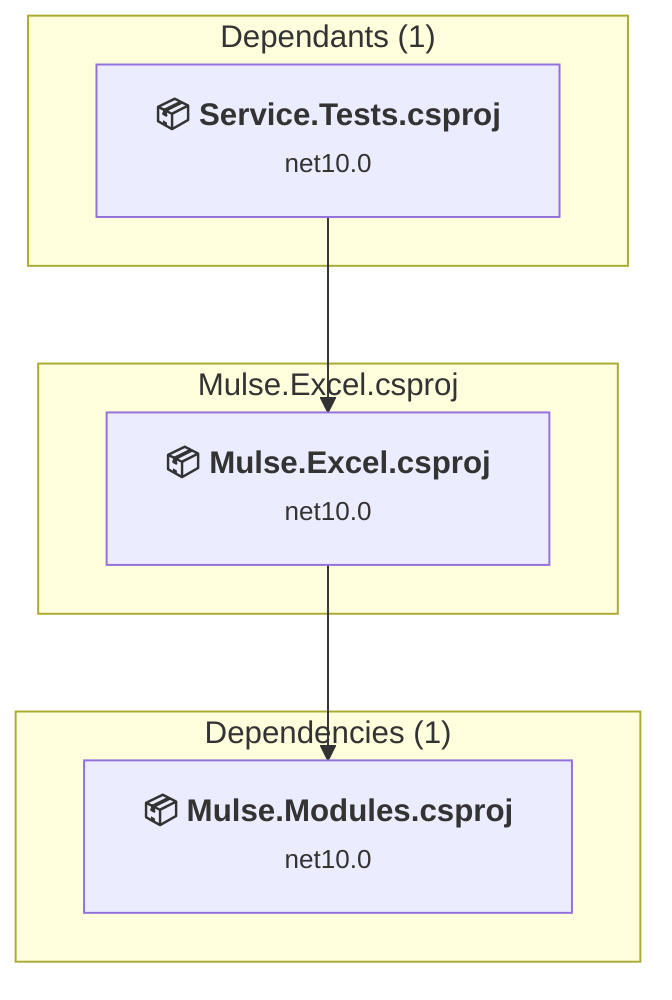

# Mulse.Excel\Mulse.Excel.csproj

[← Back to the assessment index](../../assessment.md)

## Project Info

- **Current Target Framework:** net10.0
- **Proposed Target Framework:** net11.0
- **SDK-style**: True
- **Project Kind:** ClassLibrary
- **Dependencies**: 1
- **Dependants**: 1
- **Number of Files**: 4
- **Number of Files with Incidents**: 3
- **Lines of Code**: 268
- **Estimated LOC to modify**: 9+ (at least 3.4% of the project)

## Related Projects

**Depends on (1)** — projects this one references:

- [C:\Users\LXS0610\source\repos\Mulse\Mulse.Modules\Mulse.Modules.csproj](../projects/Mulse.Modules.md)

**Depended on by (1)** — projects that reference this one:

- [C:\Users\LXS0610\source\repos\Mulse\Service.Tests\Service.Tests.csproj](../projects/Service.Tests.md)

## Dependency Graph

Legend:
📦 SDK-style project
⚙️ Classic project

## API Compatibility

| Category | Count | Impact |
| :--- | :---: | :--- |
| 🔴 Binary Incompatible | 0 | High - Require code changes |
| 🟡 Source Incompatible | 7 | Medium - Needs re-compilation and potential conflicting API error fixing |
| 🔵 Behavioral change | 2 | Low - Behavioral changes that may require testing at runtime |
| ✅ Compatible | 452 |  |
| ***Total APIs Analyzed*** | ***461*** |  |

## NuGet Package Issues

| Package | Current Version | Suggested Version | Severity | Issue |
| :--- | :---: | :---: | :---: | :--- |
| System.Security.Cryptography.Xml | 8.0.5 | 10.0.15 | 🟡 Potential | NuGet package upgrade is recommended |

Every project affected by these packages, and the versions the repository settles on: [aggregate NuGet packages](../nuget/aggregate-packages.md).

