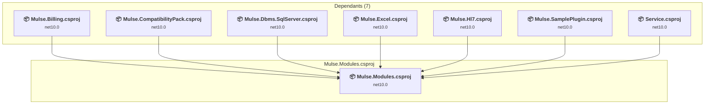

# Mulse.Modules\Mulse.Modules.csproj

[← Back to the assessment index](../../assessment.md)

## Project Info

- **Current Target Framework:** net10.0
- **Proposed Target Framework:** net11.0
- **SDK-style**: True
- **Project Kind:** ClassLibrary
- **Dependencies**: 0
- **Dependants**: 7
- **Number of Files**: 182
- **Number of Files with Incidents**: 40
- **Lines of Code**: 11012
- **Estimated LOC to modify**: 165+ (at least 1.5% of the project)

## Related Projects

**Depended on by (7)** — projects that reference this one:

- [C:\Users\LXS0610\source\repos\Mulse\Mulse.Billing\Mulse.Billing.csproj](../projects/Mulse.Billing.md)
- [C:\Users\LXS0610\source\repos\Mulse\Mulse.CompatibilityPack\Mulse.CompatibilityPack.csproj](../projects/Mulse.CompatibilityPack.md)
- [C:\Users\LXS0610\source\repos\Mulse\Mulse.Dbms.SqlServer\Mulse.Dbms.SqlServer.csproj](../projects/Mulse.Dbms.SqlServer.md)
- [C:\Users\LXS0610\source\repos\Mulse\Mulse.Excel\Mulse.Excel.csproj](../projects/Mulse.Excel.md)
- [C:\Users\LXS0610\source\repos\Mulse\Mulse.Hl7\Mulse.Hl7.csproj](../projects/Mulse.Hl7.md)
- [C:\Users\LXS0610\source\repos\Mulse\Mulse.SamplePlugin\Mulse.SamplePlugin.csproj](../projects/Mulse.SamplePlugin.md)
- [C:\Users\LXS0610\source\repos\Mulse\Service\Service.csproj](../projects/Service.md)

## Dependency Graph

Legend:
📦 SDK-style project
⚙️ Classic project

## API Compatibility

| Category | Count | Impact |
| :--- | :---: | :--- |
| 🔴 Binary Incompatible | 0 | High - Require code changes |
| 🟡 Source Incompatible | 109 | Medium - Needs re-compilation and potential conflicting API error fixing |
| 🔵 Behavioral change | 56 | Low - Behavioral changes that may require testing at runtime |
| ✅ Compatible | 17832 |  |
| ***Total APIs Analyzed*** | ***17997*** |  |

## NuGet Package Issues

| Package | Current Version | Suggested Version | Severity | Issue |
| :--- | :---: | :---: | :---: | :--- |
| Microsoft.Extensions.DependencyInjection | 10.0.14 | 10.0.15 | 🟡 Potential | NuGet package upgrade is recommended |
| Microsoft.Extensions.Http | 10.0.14 | 10.0.15 | 🟡 Potential | NuGet package upgrade is recommended |
| Microsoft.Extensions.Logging.Abstractions | 10.0.14 | 10.0.15 | 🟡 Potential | NuGet package upgrade is recommended |
| System.Memory.Data | 10.0.14 | 10.0.15 | 🟡 Potential | NuGet package upgrade is recommended |

Every project affected by these packages, and the versions the repository settles on: [aggregate NuGet packages](../nuget/aggregate-packages.md).

