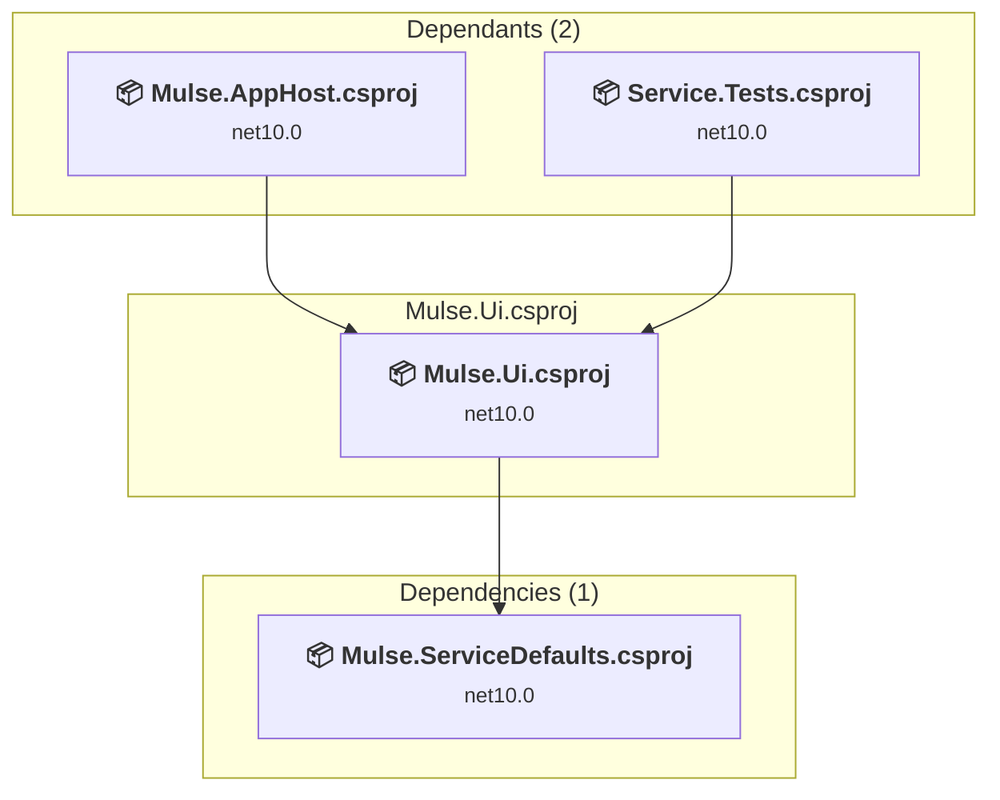

# Mulse.Ui\Mulse.Ui.csproj

[← Back to the assessment index](../../assessment.md)

## Project Info

- **Current Target Framework:** net10.0
- **Proposed Target Framework:** net11.0
- **SDK-style**: True
- **Project Kind:** AspNetCore
- **Dependencies**: 1
- **Dependants**: 2
- **Number of Files**: 124
- **Number of Files with Incidents**: 17
- **Lines of Code**: 5149
- **Estimated LOC to modify**: 48+ (at least 0.9% of the project)

## Related Projects

**Depends on (1)** — projects this one references:

- [C:\Users\LXS0610\source\repos\Mulse\Mulse.ServiceDefaults\Mulse.ServiceDefaults.csproj](../projects/Mulse.ServiceDefaults.md)

**Depended on by (2)** — projects that reference this one:

- [C:\Users\LXS0610\source\repos\Mulse\Mulse.AppHost\Mulse.AppHost.csproj](../projects/Mulse.AppHost.md)
- [C:\Users\LXS0610\source\repos\Mulse\Service.Tests\Service.Tests.csproj](../projects/Service.Tests.md)

## Dependency Graph

Legend:
📦 SDK-style project
⚙️ Classic project

## API Compatibility

| Category | Count | Impact |
| :--- | :---: | :--- |
| 🔴 Binary Incompatible | 0 | High - Require code changes |
| 🟡 Source Incompatible | 1 | Medium - Needs re-compilation and potential conflicting API error fixing |
| 🔵 Behavioral change | 47 | Low - Behavioral changes that may require testing at runtime |
| ✅ Compatible | 48651 |  |
| ***Total APIs Analyzed*** | ***48699*** |  |

