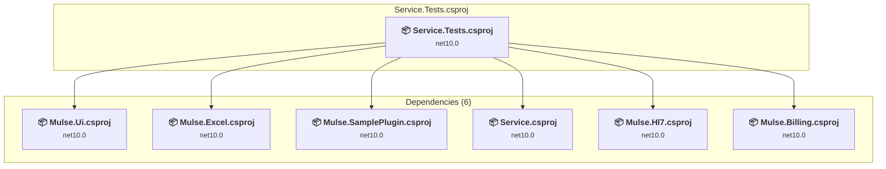

# Service.Tests\Service.Tests.csproj

[← Back to the assessment index](../../assessment.md)

## Project Info

- **Current Target Framework:** net10.0
- **Proposed Target Framework:** net11.0
- **SDK-style**: True
- **Project Kind:** DotNetCoreApp
- **Dependencies**: 6
- **Dependants**: 0
- **Number of Files**: 158
- **Number of Files with Incidents**: 92
- **Lines of Code**: 28539
- **Estimated LOC to modify**: 528+ (at least 1.9% of the project)

## Related Projects

**Depends on (6)** — projects this one references:

- [C:\Users\LXS0610\source\repos\Mulse\Mulse.Billing\Mulse.Billing.csproj](../projects/Mulse.Billing.md)
- [C:\Users\LXS0610\source\repos\Mulse\Mulse.Excel\Mulse.Excel.csproj](../projects/Mulse.Excel.md)
- [C:\Users\LXS0610\source\repos\Mulse\Mulse.Hl7\Mulse.Hl7.csproj](../projects/Mulse.Hl7.md)
- [C:\Users\LXS0610\source\repos\Mulse\Mulse.SamplePlugin\Mulse.SamplePlugin.csproj](../projects/Mulse.SamplePlugin.md)
- [C:\Users\LXS0610\source\repos\Mulse\Mulse.Ui\Mulse.Ui.csproj](../projects/Mulse.Ui.md)
- [C:\Users\LXS0610\source\repos\Mulse\Service\Service.csproj](../projects/Service.md)

## Dependency Graph

Legend:
📦 SDK-style project
⚙️ Classic project

## API Compatibility

| Category | Count | Impact |
| :--- | :---: | :--- |
| 🔴 Binary Incompatible | 0 | High - Require code changes |
| 🟡 Source Incompatible | 254 | Medium - Needs re-compilation and potential conflicting API error fixing |
| 🔵 Behavioral change | 274 | Low - Behavioral changes that may require testing at runtime |
| ✅ Compatible | 94315 |  |
| ***Total APIs Analyzed*** | ***94843*** |  |

## NuGet Package Issues

| Package | Current Version | Suggested Version | Severity | Issue |
| :--- | :---: | :---: | :---: | :--- |
| xunit | 2.9.3 | — | 🔵 Optional | NuGet package is deprecated |

Every project affected by these packages, and the versions the repository settles on: [aggregate NuGet packages](../nuget/aggregate-packages.md).

