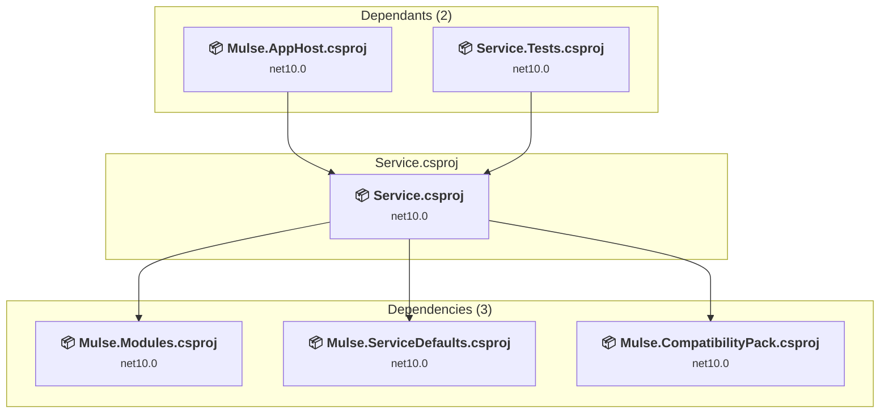

# Service\Service.csproj

[← Back to the assessment index](../../assessment.md)

## Project Info

- **Current Target Framework:** net10.0
- **Proposed Target Framework:** net11.0
- **SDK-style**: True
- **Project Kind:** AspNetCore
- **Dependencies**: 3
- **Dependants**: 2
- **Number of Files**: 406
- **Number of Files with Incidents**: 32
- **Lines of Code**: 16864
- **Estimated LOC to modify**: 254+ (at least 1.5% of the project)

## Related Projects

**Depends on (3)** — projects this one references:

- [C:\Users\LXS0610\source\repos\Mulse\Mulse.CompatibilityPack\Mulse.CompatibilityPack.csproj](../projects/Mulse.CompatibilityPack.md)
- [C:\Users\LXS0610\source\repos\Mulse\Mulse.Modules\Mulse.Modules.csproj](../projects/Mulse.Modules.md)
- [C:\Users\LXS0610\source\repos\Mulse\Mulse.ServiceDefaults\Mulse.ServiceDefaults.csproj](../projects/Mulse.ServiceDefaults.md)

**Depended on by (2)** — projects that reference this one:

- [C:\Users\LXS0610\source\repos\Mulse\Mulse.AppHost\Mulse.AppHost.csproj](../projects/Mulse.AppHost.md)
- [C:\Users\LXS0610\source\repos\Mulse\Service.Tests\Service.Tests.csproj](../projects/Service.Tests.md)

## Dependency Graph

Legend:
📦 SDK-style project
⚙️ Classic project

## API Compatibility

| Category | Count | Impact |
| :--- | :---: | :--- |
| 🔴 Binary Incompatible | 1 | High - Require code changes |
| 🟡 Source Incompatible | 24 | Medium - Needs re-compilation and potential conflicting API error fixing |
| 🔵 Behavioral change | 229 | Low - Behavioral changes that may require testing at runtime |
| ✅ Compatible | 34466 |  |
| ***Total APIs Analyzed*** | ***34720*** |  |

## NuGet Package Issues

| Package | Current Version | Suggested Version | Severity | Issue |
| :--- | :---: | :---: | :---: | :--- |
| Microsoft.AspNetCore.OpenApi | 10.0.14 | 10.0.15 | 🟡 Potential | NuGet package upgrade is recommended |
| Microsoft.VisualStudio.Azure.Containers.Tools.Targets | 1.24.2-preview.1 | — | 🔴 Mandatory | NuGet package is incompatible |

Every project affected by these packages, and the versions the repository settles on: [aggregate NuGet packages](../nuget/aggregate-packages.md).

